<div align="center">

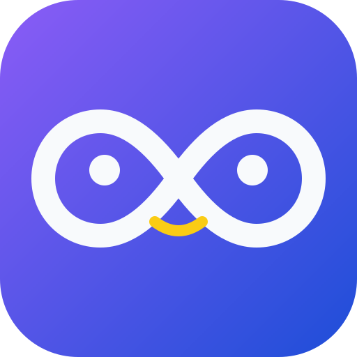

# Loppy

### Aprende a programar, vuelta a vuelta. 🔁

Retos cortos de **Python**, **SQL Server** y **Power BI**, con rachas, XP y niveles, directo en el navegador y sin instalar nada.

[](https://loppy-code.netlify.app)

[](https://app.netlify.com/projects/loppy-code/deploys)


<br />

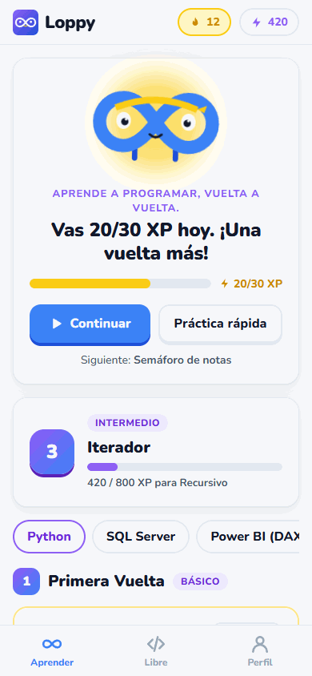

<sub>Escribes el código, lo ejecutas y Loppy te avisa al instante si quedó bien.</sub>

</div>

---

## ✨ Qué hace especial a Loppy

<table>
<tr>
<td width="33%" valign="top">

### 🐍 Python de verdad
Tu código corre en un **Python real dentro del navegador** (Pyodide). No hay servidor, no cuesta nada y funciona sin internet.

</td>
<td width="33%" valign="top">

### 🔥 Rachas y niveles
Una meta diaria de XP, rachas que cambian la apariencia de Loppy y 6 niveles: de *Primera Vuelta* a **Loop Infinito ∞**.

</td>
<td width="33%" valign="top">

### 💛 Sin castigos
No hay vidas que perder. Equivocarse es gratis: es otra vuelta del loop. Los errores se explican con palabras amables.

</td>
</tr>
<tr>
<td valign="top">

### 📱 Hecha para el teléfono
Se instala como app (PWA) en iPhone y Android. El editor trae una barra de símbolos `( ) : " [ ]` para el teclado del móvil.

</td>
<td valign="top">

### ☁️ Tu progreso, en todos lados
Si creas una cuenta (es opcional), tu progreso se sincroniza entre dispositivos en vivo, sin perder nada.

</td>
<td valign="top">

### 🧪 Retos verificados
Cada reto se comprueba con pruebas automáticas, así que no basta con imprimir el texto: tu **lógica** también se pone a prueba.

</td>
</tr>
</table>

## 📸 Recorrido

<div align="center">
<table>
<tr>
<td align="center">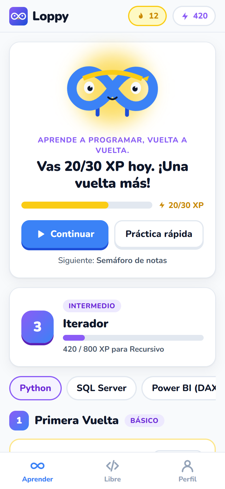<br /><b>Inicio</b><br /><sub>Meta del día y nivel</sub></td>
<td align="center">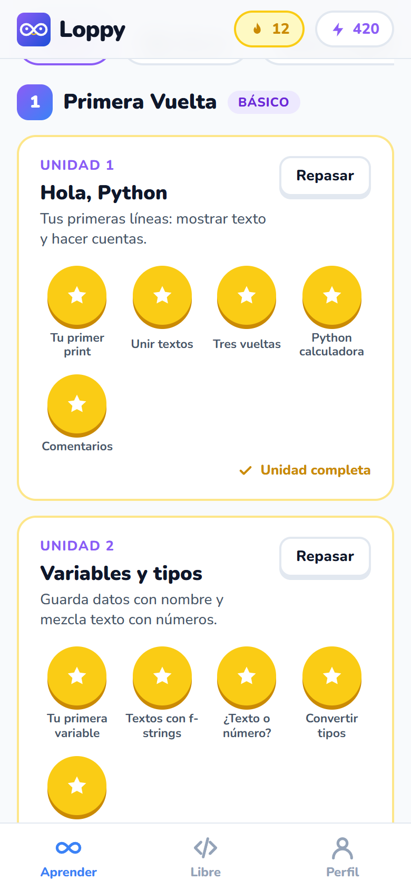<br /><b>Camino</b><br /><sub>Unidades y retos</sub></td>
<td align="center">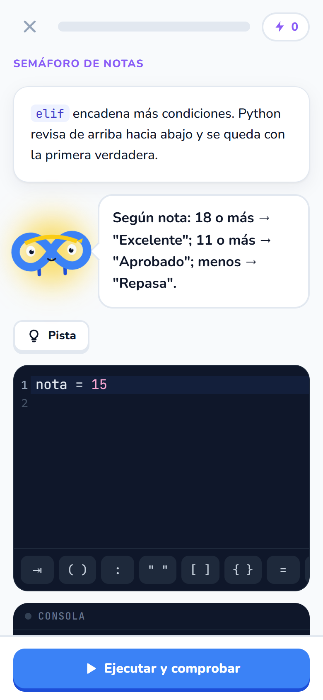<br /><b>Reto de código</b><br /><sub>Escribe y ejecuta</sub></td>
</tr>
<tr>
<td align="center">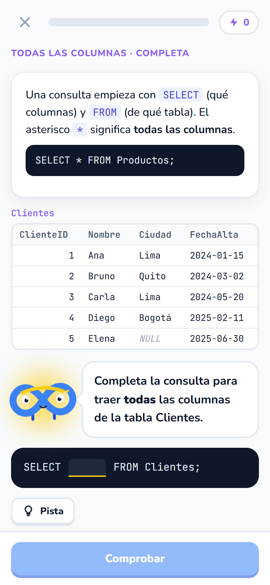<br /><b>SQL Server</b><br /><sub>Consultas sobre tablas reales</sub></td>
<td align="center">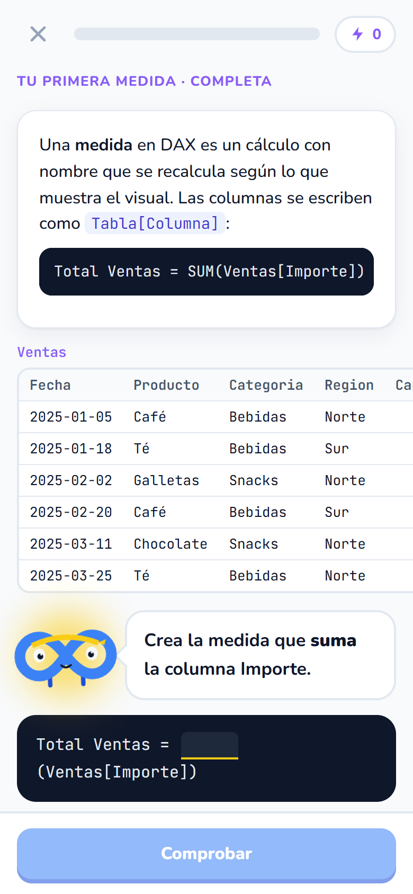<br /><b>Power BI</b><br /><sub>Medidas DAX y Power Query (M)</sub></td>
<td align="center">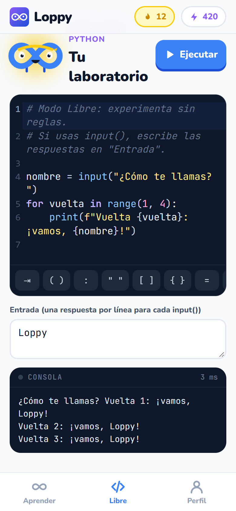<br /><b>Modo Libre</b><br /><sub>Tu laboratorio de Python</sub></td>
</tr>
</table>

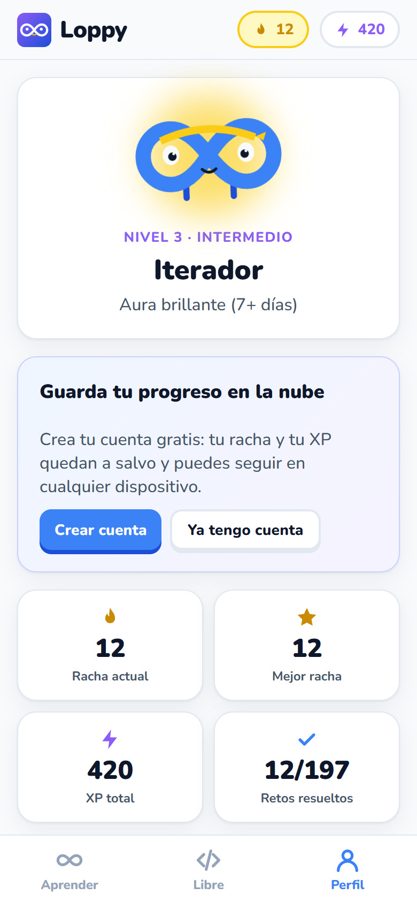<br /><b>Perfil</b> · <sub>racha, XP y cuenta en la nube</sub>
</div>

## 🔁 Cómo se practica

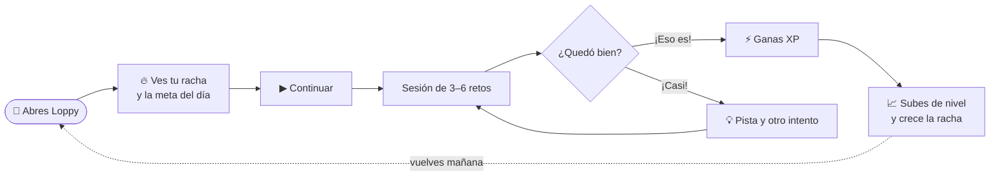

**Tipos de reto**

| Tipo | Qué haces | Dónde |
|---|---|---|
| ✍️ **Código** | Escribes el programa desde cero; Loppy lo ejecuta y lo prueba con otros valores | Python |
| 🔮 **Predice** | Lees un código y eliges qué imprime | Todos los cursos |
| 🧩 **Completa** | Llenas los huecos `___` o escribes el resultado | SQL Server y Power BI |

## 📚 Cursos

| Curso | Retos | Cómo se practica |
|---|:---:|---|
| 🐍 **Python** | 88 | Se ejecuta de verdad en el navegador (16 unidades, de `print` a recursión) |
| 🗄️ **SQL Server (T-SQL)** | 60 | Marcar y escribir consultas sobre una mini tienda (Clientes, Productos, Pedidos) |
| 📊 **Power BI (DAX y M)** | 49 | Marcar y escribir medidas sobre una tabla de Ventas y Metas |
| ⏳ JavaScript · C++ · Java · R | — | Próximamente |

<details>
<summary><b>🏅 Ver los 6 niveles de dominio</b></summary>

<br />

| # | Nivel | Tipo | XP necesario |
|:---:|---|---|---:|
| 1 | Primera Vuelta | Básico | 0 |
| 2 | Bucle Curioso | Principiante | 120 |
| 3 | Iterador | Intermedio | 350 |
| 4 | Recursivo | Avanzado | 800 |
| 5 | Maestro del Loop | Maestro | 1 600 |
| 6 | **Loop Infinito ∞** | Leyenda | 3 000 |

La racha también cambia a Loppy: **1+ día** bandana violeta · **3+** dorada · **7+** aura brillante · **30+** aura arcoíris.

</details>

## 🏗️ Arquitectura

Todo lo importante pasa **en el navegador**. La nube solo guarda el progreso de quien crea una cuenta.

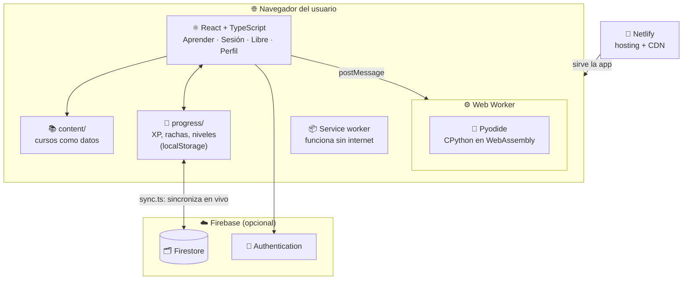

<details>
<summary><b>⚙️ Qué pasa cuando tocas «Ejecutar y comprobar»</b></summary>

<br />

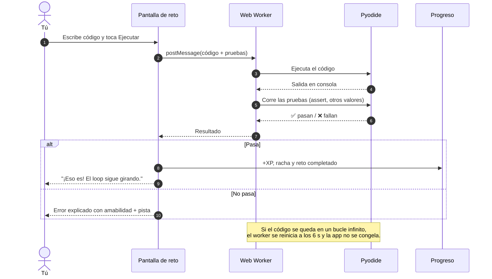

</details>

## 🚀 Ejecutar en local

> Necesitas [Node.js](https://nodejs.org) 24 o más nuevo.

```bash
git clone <url-de-este-repo>
cd Loppy
npm install
npm run dev
```

Abre <http://localhost:5173>. La primera vez que ejecutes código se descarga Python (~10 MB) y después queda guardado.

| Comando | Qué hace |
|---|---|
| `npm run dev` | Abre la app en modo desarrollo |
| `npm run build` | Revisa los tipos y genera la versión para publicar en `dist/` |
| `npm run check:content` | Ejecuta **todos** los retos de Python y revisa la estructura de los demás |
| `npm run typecheck` | Solo revisa TypeScript |

## 🔄 Del código a la app publicada

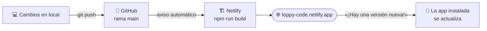

## 🗂️ Estructura

```
Loppy
├─ public/              icono, manifest e iconos de la PWA
├─ src/
│  ├─ brand.ts          nombre, eslogan y frases de ánimo
│  ├─ screens/          Learn, Session, Playground, Profile
│  ├─ components/       Loppy (mascota), CodeEditor, Console, DataTables…
│  ├─ content/          cursos: python/, sqlserver/, powerbi/
│  ├─ engine/           Python en un Web Worker + errores amables
│  ├─ progress/         XP, rachas y niveles
│  ├─ cloud/            Firebase: cuentas y sincronización
│  └─ pwa/              service worker y avisos de versión nueva
├─ scripts/             check-content: verifica que todos los retos funcionen
├─ firestore.rules      reglas de seguridad de la base de datos
└─ docs/ARQUITECTURA.md decisiones técnicas en detalle
```

## 🗺️ Roadmap

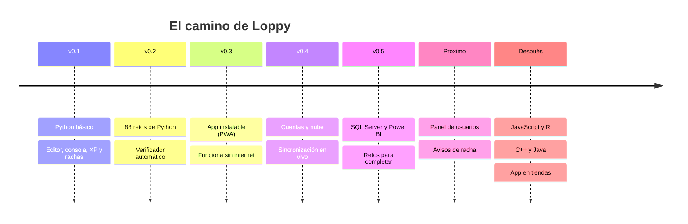

- [x] Python, SQL Server y Power BI
- [x] PWA instalable y sin conexión
- [x] Cuentas opcionales con sincronización
- [ ] Panel de usuarios (activos hoy, retos más difíciles)
- [ ] Avisos de racha con Firebase Cloud Messaging
- [ ] Reto diario
- [ ] JavaScript y R en el navegador · C++ y Java en un sandbox
- [ ] App para iOS y Android con Capacitor

Para más detalle, revisa [docs/ARQUITECTURA.md](docs/ARQUITECTURA.md).

---

<div align="center">
<sub>Hecho con 💙 y muchas vueltas de loop.</sub>
</div>
